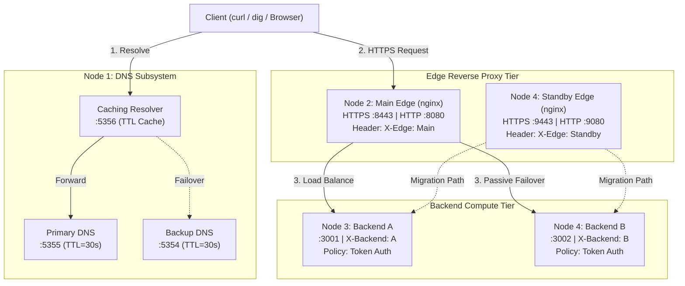

# Private Network Service Platform (Phase 1 & Phase 2)


-orange?style=flat)
-brightgreen?style=flat)

> **"The application stays simple — the network is the project."**

This repository contains the architecture, implementation, and empirical evaluation of a hardened multi-tier private network service platform built as a controlled laboratory environment. Rather than focusing on complex application logic, this project implements decoupled networking infrastructure to examine and verify behavior across the network protocol stack (DNS, TCP, TLS, HTTP, and load balancing).

All services run on **one physical Apple Silicon MacBook**, simulating a four-machine network topology using decoupled, isolated daemon processes and loopback socket bindings on `127.0.0.1`.

---

## Architecture Overview



### Single-Mac Simulation Mapping

The four logical machines defined in the course specification are mapped to isolated daemon processes on macOS:
- **Logical Machine 1 (DNS & Client)**: Authoritative Primary DNS (`:5355`), Authoritative Backup DNS (`:5354`), Caching Resolver (`:5356`), and client testing utilities.
- **Logical Machine 2 (Main Edge)**: Primary `nginx` reverse proxy with TLS 1.3 termination (`:8443`), cleartext proxy (`:8080`), response caching, and upstream load balancing.
- **Logical Machine 3 (Backend Server A)**: Application server running on port `3001` (`X-Backend: A`) with service isolation enforcement.
- **Logical Machine 4 (Backend Server B & Standby Edge)**: Application server running on port `3002` (`X-Backend: B`) and Standby `nginx` reverse proxy running on port `9443` (`X-Edge: Standby`).

---

## Feature Summary

### Phase 1: Foundation Baseline
- **Private DNS**: Domain `app.cnproject.test` resolved via `dnsmasq`.
- **Reverse Proxy & Load Balancing**: `nginx` round-robin proxying across Python HTTP backends.
- **HTTPS & TLS 1.3**: Secure TLS termination with custom Certificate Authority (CA) and SAN extensions.
- **Response Caching**: Edge microcaching with `X-Cache-Status` headers (`HIT`, `MISS`, `EXPIRED`).
- **Protocol Analysis**: Wireshark captures of TCP handshakes, TLS negotiation, and failure scenarios.

### Phase 2: Network Hardening & Failover Extensions
- **Extension A (Backup DNS)**: Independent backup DNS resolver (`:5354`) with client-side failover script (`scripts/dns_client_resolver.sh`).
- **Extension B (DNS TTL & Cache)**: 30-second authoritative TTL with local caching forwarder (`:5356`), demonstrating TTL countdown, stale cache retention during IP migration (`127.0.0.2`), expiration, and manual SIGHUP cache flush.
- **Extension C (Service Isolation)**: Application-layer token isolation; direct backend access is rejected with `HTTP 403 Forbidden` (`X-Isolation-Status: Blocked-Direct-Access-Denied`), while edge-proxied requests inject the token and return `HTTP 200 OK`.
- **Extension D (High Availability)**: Upstream passive health monitoring (`max_fails=1 fail_timeout=5s`) and failover routing (`proxy_next_upstream`) redirecting failed requests to the healthy backend during a single-node outage in sequential tests.
- **Extension E (Standby Edge Migration)**: Standby reverse proxy (`:9443`, `X-Edge: Standby`) with controlled DNS cutover and verified rollback to the main edge.
- **Extension F (Diagnostic Engine & Fault Manager)**: Automated Layer 1–7 diagnostic scanner (`scripts/diagnose_stack.sh`) and fault injection engine (`scripts/fault_manager.sh`).

---

## Port Allocation Reference

| Subsystem / Service | Node | Protocol | Port | Description | Health Check Command |
| :--- | :--- | :--- | :--- | :--- | :--- |
| **Primary DNS** | Node 1 | UDP/TCP | `5355` | Authoritative Primary DNS (TTL=30) | `dig @127.0.0.1 -p 5355 app.cnproject.test` |
| **Backup DNS** | Node 1 | UDP/TCP | `5354` | Authoritative Backup DNS (TTL=30) | `dig @127.0.0.1 -p 5354 app.cnproject.test` |
| **Caching Resolver** | Node 1 | UDP/TCP | `5356` | Local Caching Forwarder (150 names) | `dig @127.0.0.1 -p 5356 app.cnproject.test` |
| **Main Edge (HTTPS)** | Node 2 | TCP | `8443` | Primary Proxy & TLS Termination | `curl -k https://127.0.0.1:8443/api/status` |
| **Main Edge (HTTP)** | Node 2 | TCP | `8080` | Primary Cleartext Proxy | `curl http://127.0.0.1:8080/api/status` |
| **Standby Edge (HTTPS)** | Node 4 | TCP | `9443` | Standby Proxy & TLS Termination | `curl -k https://127.0.0.1:9443/api/status` |
| **Standby Edge (HTTP)** | Node 4 | TCP | `9080` | Standby Cleartext Proxy | `curl http://127.0.0.1:9080/api/status` |
| **Backend Server A** | Node 3 | TCP | `3001` | Upstream Server Node A | `curl http://127.0.0.1:3001/health` |
| **Backend Server B** | Node 4 | TCP | `3002` | Upstream Server Node B | `curl http://127.0.0.1:3002/health` |
| **NOC Web Dashboard** | Host | TCP | `8000` | Real-time Operations Dashboard | `http://127.0.0.1:8000/` |

---

## Quick Start & Verification

### 1. Prerequisites
- macOS Apple Silicon (arm64)
- Homebrew dependencies: `brew install dnsmasq nginx wireshark python3`

### 2. Service Management
```bash
# Start all 4 logical machines (DNS, Main Edge, Standby Edge, Backends)
./scripts/manage_services.sh start-all

# Check live health status of all subsystems
./scripts/manage_services.sh status

# Stop all background processes
./scripts/manage_services.sh stop-all
```

### 3. Centralized NOC Dashboard
Launch the live web dashboard for real-time monitoring and fault injection:
```bash
python3 scripts/dashboard_server.py &
open http://127.0.0.1:8000/
```
The dashboard auto-refreshes every 2 seconds, displaying process statuses, PIDs, active DNS IPs, and interactive demonstration controls.

### 4. Running Test Suites
```bash
# Execute master verification suite (runs Extensions A through F sequentially)
./scripts/run_all_phase2_tests.sh

# Run individual test suites
./scripts/test_dns_failover.sh       # Extension A: DNS failover
./scripts/test_dns_ttl.sh            # Extension B: TTL countdown & cache flush
./scripts/test_service_isolation.sh  # Extension C: 403 vs 200 token isolation
./scripts/test_ha_failover.sh        # Extension D: Upstream failure & auto-recovery
./scripts/test_edge_migration.sh     # Extension E: Standby cutover & rollback
./scripts/diagnose_stack.sh          # Extension F: Layer 1-7 diagnostic scan
```

---

## Documentation Index

Detailed architectural analyses, configuration guides, and evaluation reports are organized in the [`docs/`](docs/) directory:

- [`docs/README.md`](docs/README.md) — Master documentation index and guide.
- [`docs/PHASE2_FINAL_REPORT.md`](docs/PHASE2_FINAL_REPORT.md) — Academic report covering Sections 1–10.
- [`docs/ARCHITECTURE.md`](docs/ARCHITECTURE.md) — System topology, sequence diagrams, and port allocations.
- [`docs/TESTING_AND_EVIDENCE.md`](docs/TESTING_AND_EVIDENCE.md) — Test reproduction steps, terminal outputs, and pcap references.
- [`docs/CONFIGURATION_GUIDE.md`](docs/CONFIGURATION_GUIDE.md) — DNS configurations, nginx blocks, and secrets setup.
- [`docs/TROUBLESHOOTING.md`](docs/TROUBLESHOOTING.md) — Layer 1–7 diagnostic hierarchy and fault recovery matrix.
- [`docs/VIVA_QUESTIONS.md`](docs/VIVA_QUESTIONS.md) — 30 technical viva examination questions with architectural answers.
- [`docs/FINAL_PRESENTATION.md`](docs/FINAL_PRESENTATION.md) — 12-slide demonstration deck outline.
- [`docs/PHASE1_BASELINE_README.md`](docs/PHASE1_BASELINE_README.md) — Complete original Phase 1 documentation baseline.

---

## Evidence & Wireshark Captures

Verified runtime logs and loopback `.pcapng` packet captures are maintained in [`evidence/`](evidence/):
- [`evidence/README.md`](evidence/README.md) — Index of all Phase 1 and Phase 2 evidence.
- [`evidence/phase-2/master-phase2-test-report.txt`](evidence/phase-2/master-phase2-test-report.txt) — Unified test execution output.
- [`evidence/phase-2/backup-dns-failover.pcapng`](evidence/phase-2/backup-dns-failover.pcapng) — Primary DNS timeout and backup resolution capture.
- [`evidence/phase-2/dns-ttl-capture.pcapng`](evidence/phase-2/dns-ttl-capture.pcapng) — 30-second TTL countdown and cache expiration capture.

---

## Limitations & Single-Mac Adaptations

1. **Host-Level Fault Domain**: All four simulated nodes share one physical macOS kernel and CPU. Hardware failure or operating system restart impacts all nodes concurrently.
2. **DNS Port Invariance**: Standard DNS A-records resolve domain names to IP addresses without port information. Routing between Main Edge (`:8443`) and Standby Edge (`:9443`) on the same host requires port-aware client targeting or distinct loopback IP aliases (`127.0.0.1` vs `127.0.0.2`).
3. **Loopback Traffic Encapsulation**: All inter-node traffic traverses the Darwin loopback interface (`lo0`) rather than physical Ethernet/Wi-Fi hardware, which eliminates real-world physical wire latency, propagation delay, and transmission errors.
4. **Firewall vs. Application-Layer Isolation**: Because macOS loopback packet filtering (`pf`) cannot distinguish between local processes sharing `127.0.0.1`, service isolation is enforced at the application layer via HTTP header token validation (`X-CN-Edge-Token`) rather than OS-level firewall packet filtering.

---

## Conclusion & Repository Status

This platform demonstrates controlled network resilience, failover mechanics, and protocol inspection within a lab-scale simulated multi-tier architecture on a single physical machine.

- **Author**: Ritik Raj
- **Git Branch**: `phase2-single-mac`
- **Backup Baseline**: `phase1-backup` (Commit `560da04`)
- **Remote Repository**: [GitHub — Ritik-62/CN-Project](https://github.com/Ritik-62/CN-Project)
