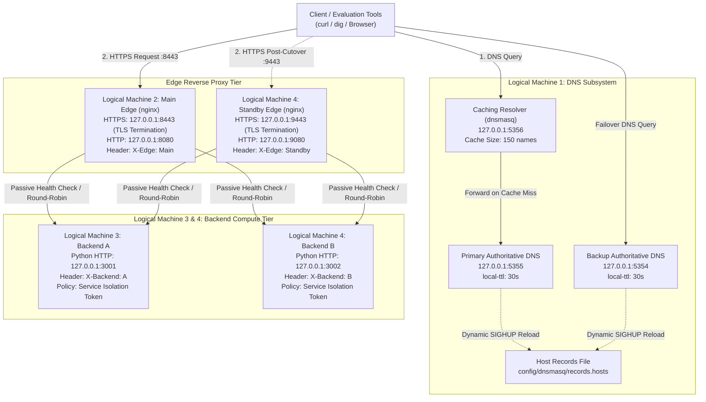
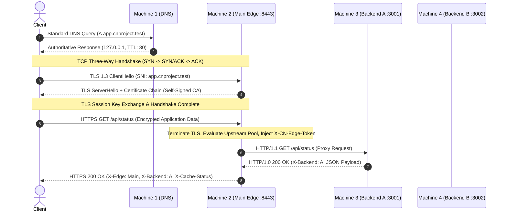

# System Architecture — Private Network Service Platform

## 1. System Overview
The Private Network Service Platform is a local, resilient network environment designed to demonstrate core networking protocols: DNS resolution, caching, TCP connection lifecycle, TLS termination, reverse proxy load balancing, service isolation, and edge failover.

The implementation runs entirely on **a single physical Apple Silicon macOS workstation**. The four logical machines specified in the course design are implemented as dedicated, decoupled daemon processes bound to distinct ports and loopback sockets on `127.0.0.1`.

---

## 2. End-to-End Logical Architecture

---

## 3. Logical Machine Mapping & Role Isolation

| Logical Node | Simulated Hardware Role | Running Service & Port | Configuration Artifact | Process Isolation |
|---|---|---|---|---|
| **Machine 1** | Primary Nameserver & Client | Primary DNS (`:5355`) Backup DNS (`:5354`) Caching Resolver (`:5356`) | `config/dnsmasq/dnsmasq-primary.conf` `config/dnsmasq/dnsmasq-backup.conf` `config/dnsmasq/dnsmasq-cache.conf` | Distinct PID files: `/tmp/dnsmasq-primary.pid`, `/tmp/dnsmasq-backup.pid`, `/tmp/dnsmasq-cache.pid` |
| **Machine 2** | Edge Reverse Proxy & Load Balancer | Main nginx (`:8443` SSL / `:8080` HTTP) | `config/nginx/nginx-main.conf` | PID: `/tmp/nginx-main.pid`, dedicated logs in `/tmp/nginx-main-*.log` |
| **Machine 3** | Backend Compute Node A | Python HTTP Server (`:3001`) | `backends/backend-a/server.py` | PID: `/tmp/backend-a.pid`, standard out log `/tmp/backend-a.log` |
| **Machine 4** | Backend Compute Node B & Standby Edge | Python HTTP Server (`:3002`) Standby nginx (`:9443` SSL / `:9080` HTTP) | `backends/backend-b/server.py` `config/nginx/nginx-standby.conf` | PIDs: `/tmp/backend-b.pid`, `/tmp/nginx-standby.pid` |

---

## 4. Network Protocol Flow & Data Path

---

## 5. Architectural Invariants
1. **Single Physical Workstation**: No external virtual machines, containers, or remote hosts are assumed. All communications occur via loopback sockets.
2. **Deterministic Port Allocations**: All ports exceed 1024, enabling clean execution under macOS standard non-root privileges.
3. **Decoupled Configuration**: Every logical component maintains independent configuration and state tracking, allowing any service to be halted without cascading failures to unrelated daemons.
